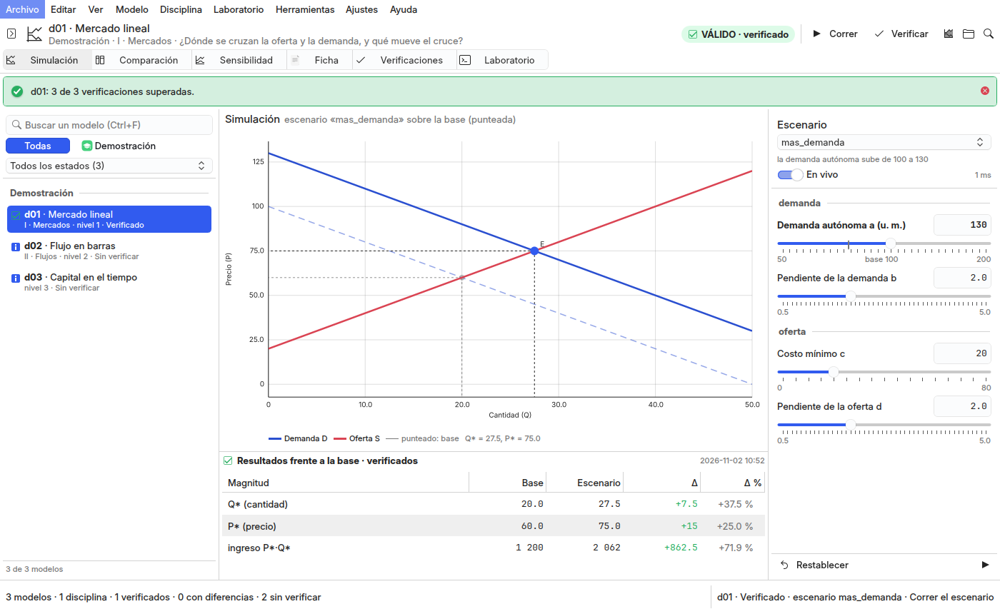

# Reingeniería de Simuladores Studio: diagnóstico, distribución y decisiones

Encargo del autor del 2026-11-02 (§3.8 de la instrucción maestra de la reingeniería de los diez studios, con §4–§6):
Simuladores Studio debe parecer un laboratorio de simulación científica, no un explorador de archivos: el área
principal es un espacio de trabajo científico, no una tabla; los gráficos se actualizan al mover los parámetros cuando
el modelo lo permite; y **un resultado no se muestra como válido si sus verificaciones no pasaron**. Este documento es
el diagnóstico de la ventana 2.0 (la de la fase 5, `docs/rediseno.md`), la distribución nueva y sus decisiones
(L1–L12). Lo construido, cómo se verificó y lo que quedó fuera, en §4 y §5.

## 1. Diagnóstico de la ventana 2.0 (leído en el código, `respaldo/antes-reingenieria-2026-11-02`)

Capturas de antes: `docs/figuras/antes/simuladores-studio-{oscuro,claro,paleta}.png`.

### 1.1 Qué hace cada pieza hoy

| pieza | dónde | qué hace de verdad |
|---|---|---|
| catálogo | `studio/sim_app/servicios/laboratorio.py`, `catalogo.json` | los modelos por disciplina sin importarlos; cada disciplina se activa a demanda (sus `config` y `modelos` no conviven en `sys.modules`). **Correcto** |
| tabla de modelos | `studio/sim_app/controladores/modelos.py`, `Main.qml` | una `TablaDatos` (Id · Modelo · Estado) es la vista principal |
| escenario | el formulario `Escenario` (retirado) | un formulario con un control por parámetro; los cambios **no recalculan**: hay que pulsar F5 con «Correr el escenario» elegido en un combo |
| corrida | `studio/sim_app/servicios/corridas.py` | `navegador.calcular` (el mismo cálculo que el navegador de los pubs) y las magnitudes frente a la base. Correcto |
| gráfico | `corridas.para_grafico`, `GuiComun.Grafico` (QuickCharts) | QuickCharts sitúa cada valor por su índice: las líneas se **remuestrean** en una rejilla común (una curva con x no uniforme se deforma) y las barras salen de **un solo color** (el modelo las colorea por su sentido: filtraciones e inyecciones) |
| verificaciones | `studio/sim_app/servicios/verificaciones.py` | `base.verificar` y las citas; el estado por modelo con la huella del archivo. **Correcto**, pero el resultado de una corrida se muestra igual aunque el modelo tenga verificaciones fallidas |
| ficha | `studio/sim_app/servicios/fichas.py` | Markdown con las ecuaciones dibujadas por mathtext. Correcta; sus apartados no siguen el orden pedagógico del encargo (objetivo, fundamento, ecuaciones, variables, parámetros, supuestos, limitaciones, interpretación, referencias); los **parámetros** no están |
| sensibilidad y comparación | `studio/sim_app/servicios/operaciones.py` | solo como CLI (`main.py sensibilidad`, `comparar`) con su salida de texto en el panel inferior: ningún gráfico |
| operaciones | `studio/sim_app/servicios/operaciones.py` | catálogo de operaciones en proceso y de CLI. «Comprobar las citas» se ofrece en toda disciplina aunque solo estadística tiene `main.py fuentes`: en macro responde con error |

### 1.2 Lo incompleto y lo que no se comporta

- **La distribución es la de Dolphin**: navegación · tabla de modelos · detalles en seis pestañas · consola. El gráfico
  es una pestaña del panel lateral.
- **Sin interactividad**: mover un parámetro no actualiza nada.
- **Sin escenario base y alternativo lado a lado**, sin sensibilidad gráfica, sin evolución temporal reconocible.
- **El gráfico deforma** las curvas con x no uniforme y pierde los colores del modelo (pendientes de la fase 5).
- **Validez**: una corrida de un modelo «con diferencias» o «sin verificar» se presenta como cualquier otra.
- **Datos ficticios**: ninguno. **Botones sin comportamiento**: «Comprobar las citas» en macro.

### 1.3 Problemas de KDE

`QGuiApplication` (2.6): ningún diálogo de archivos de KDE (el studio no elige archivos; abre el `.py` y la carpeta del
modelo con `xdg-open`). Con `gui-comun` 3.0, «Abrir su carpeta» pasa a `escritorio.mostrarEnDolphin` (señala el
archivo) y abrir el modelo, a `escritorio.abrirConAplicacion`.

### 1.4 Riesgos

| riesgo | mitigación |
|---|---|
| romper los contratos (`base.Modelo`, `catalogo.json`, `navegador.json`) | el motor no cambia; `main.py catalogo --verificar` y `web --verificar` en 0 antes de cada commit |
| recalcular en vivo un modelo lento | el cálculo en vivo se agenda (≈150 ms tras el último cambio) y se mide; si una corrida pasa de 400 ms, el modo en vivo se apaga para ese modelo y queda F5 |
| barrer la sensibilidad sobre un dominio donde el modelo falla | cada punto del barrido que no calcula o da un valor no finito se marca y se excluye del gráfico; la derivada solo se da si sus dos puntos calculan |
| tocar los modelos reales en las pruebas | las pruebas y las capturas usan el laboratorio de muestra (`studio/muestra.py`), con un modelo dinámico nuevo |

## 2. Referencias y distribución

| referencia | qué se toma |
|---|---|
| **MATLAB (Live Editor, apps de Simulink)** | controles de parámetro con su rango junto a la figura que se redibuja al moverlos |
| **RStudio** | el panel de la figura grande, el del entorno (los valores) y el de la consola, con la salida accesible pero no protagonista |
| **JupyterLab** | el catálogo a la izquierda y el documento (la ficha) como pestaña del espacio de trabajo |
| **aplicaciones científicas** (GeoGebra, Desmos) | el gráfico como objeto principal, con los puntos notables marcados y el escenario anterior en gris de fondo |

```
┌ [catálogo] modelo · disciplina · ESTADO DE VALIDEZ │ Simulación · Comparación · Sensibilidad · Ficha · Verificaciones · Laboratorio │ F5 Ctrl+T ┐
│ Modelos por disciplina │ gráfico grande: el escenario (sólido) sobre la base (punteado),     │ Parámetros (deslizadores   │
│ buscar · estado        │ equilibrio y puntos; «NO VÁLIDO» si fallan las verificaciones       │ con su rango, por grupo)   │
│ (disciplina › sección) │ resultados: magnitud · base · escenario · Δ · Δ %                   │ escenario · en vivo         │
└ barra de estado ───────────────────────────────────────────────────────────────────────────────────────────────────────┘
```

## 3. Decisiones

- **L1. `VentanaBase` de `gui-comun` 3.0**: catálogo a la izquierda (plegable, F9), el espacio de simulación en el
  centro con sus vistas, los parámetros a la derecha. Sin tabla como vista principal.
- **L2. Gráfico propio** (`studio/sim_app/qml/componentes/GraficoCientifico.qml`, `Canvas`): cada línea con su propio x (sin
  remuestrear), barras con el color de cada barra, puntos, equilibrio, líneas verticales y horizontales, leyenda,
  ejes con marcas «redondas» y el valor bajo el cursor. La base se dibuja punteada debajo del escenario.
- **L3. Colores del modelo por una paleta del tema** (`studio/sim_app/servicios/paleta.py`): cada color del modelo (hex, nombre de
  matplotlib, `C0`–`C9`, `tab:*`) se lleva a un rol (azul, rojo, verde, dorado, morado, cian, gris, texto) por su tono, y
  QML pinta cada rol con un color de `Kirigami.Theme`. Ningún color propio en QML.
- **L4. En vivo**: mover un deslizador recalcula el escenario (agendado, en proceso con el motor); si el modelo tarda
  más de 400 ms, el modo en vivo se apaga para él y queda F5.
- **L5. Base y escenario**: la base son los valores por defecto del modelo; el escenario, el elegido (del modelo o propio)
  o los valores de los deslizadores. «Comparación» los dibuja lado a lado con la misma escala y la tabla de diferencias,
  con la lectura y el mecanismo de transmisión del escenario.
- **L6. Sensibilidad**: un parámetro y una magnitud; `base.sensibilidad` del motor sobre una malla de su rango declarado,
  la curva con el valor actual marcado y la derivada ∂magnitud/∂parámetro (diferencias centrales).
- **L7. Evolución temporal**: cuando el eje x del modelo es el tiempo (t, periodo, año, trimestre), la vista principal se
  llama así y el gráfico lo dice; el modelo dinámico de la muestra (d03) lo prueba.
- **L8. Validez**: una corrida solo se presenta como válida si el modelo está «verificado» (todas sus verificaciones
  pasan con el archivo actual) y todos sus números son finitos. Si no, el gráfico lleva la marca «NO VÁLIDO» o «SIN
  VERIFICAR», los resultados se muestran atenuados con el motivo, y la barra lo dice. Al abrir un modelo sin estado se
  verifica solo (en proceso; los ajustes lo pueden apagar).
- **L9. Ficha pedagógica en el orden del encargo**: objetivo (la pregunta), fundamento (contexto, autores, intuición),
  ecuaciones dibujadas (mathtext) con su significado, derivación, variables, **parámetros** (tabla con rango, unidad y
  definición), supuestos, limitaciones, interpretación (equilibrio y la lectura de cada escenario), evolución, procedencia,
  referencias y fuentes.
- **L10. «Comprobar las citas» solo donde existe** (`main.py fuentes` en la disciplina); en las demás, la acción no
  aparece.
- **L11. KDE**: abrir el `.py` con su aplicación y mostrarlo en Dolphin con `escritorio` de la base.
- **L12. Atajos de un laboratorio**: F5 correr, Ctrl+T verificar, Ctrl+1–6 las vistas, F9 el catálogo, Ctrl+F
  buscar un modelo, Ctrl+Mayús+R restablecer los parámetros, Ctrl+G la figura académica, Ctrl+Intro exportar o regenerar
  tras confirmar, Ctrl+K la paleta.

## 4. Lo construido y cómo se verificó



| pieza | dónde |
|---|---|
| la ventana (L1, L11, L12) | `studio/sim_app/qml/Main.qml` sobre `VentanaBase`; `studio/sim_app/aplicacion.py` (vistas Ctrl+1–6, F9, Ctrl+F, F5, Ctrl+T, F8; `escritorio` de la base; estados de operación) |
| el catálogo | `studio/sim_app/qml/componentes/CatalogoModelos.qml` sobre `Modelos.catalogo` (una `ModeloLista` filtrada por búsqueda, disciplina y estado) |
| el gráfico (L2, L3) | `studio/sim_app/qml/componentes/GraficoCientifico.qml` (Canvas) con los datos de `studio/sim_app/servicios/simulacion.py` (`grafico`, `unir_limites`) y los roles de `studio/sim_app/servicios/paleta.py` |
| en vivo (L4) | `studio/sim_app/controladores/modelos.py`: `fijarValor` agenda la corrida (150 ms); `correr(en_vivo=True)` mide y apaga el modo en vivo de un modelo lento (400 ms) |
| base y escenario (L5) | `graficoBase`, `limitesComunes`; `studio/sim_app/qml/componentes/Comparacion.qml` |
| sensibilidad (L6) | `simulacion.sensibilidad` sobre `base.sensibilidad`; `studio/sim_app/qml/componentes/Sensibilidad.qml` |
| evolución temporal (L7) | `simulacion.es_temporal`; el modelo dinámico d03 de `studio/muestra.py` |
| validez (L8) | `simulacion.validez` y `Modelos.validez`; la marca del gráfico, el aviso y la tabla atenuada de `studio/sim_app/qml/componentes/EspacioSimulacion.qml`, el chip de la cabecera; verificar al abrir |
| ficha (L9) | `studio/sim_app/servicios/fichas.py` |
| fuentes (L10) | `operaciones.disponible`; `Operaciones.lista` y la acción `op.fuentes` solo donde la disciplina tiene `cmd_fuentes` |

Además: la ficha dibujaba cada ecuación tres veces (el importador de Markdown de Qt partía el texto alternativo en
sus escapes LaTeX, `b\,Q`, e insertaba la imagen una vez por trozo); el texto alternativo ya no lleva escapes.
`corridas.para_grafico`, el remuestreo para QuickCharts, se retiró.

Verificación (2026-11-02, rama `wip/2026-11-02-reingenieria`):

- `tests/run.sh`: 41 pruebas (las 27 de antes, adaptadas, y la paleta, el gráfico con x no uniforme, la validez, la
  sensibilidad, el recálculo en vivo, verificar al abrir, «fuentes» por disciplina; cada componente QML se carga sin y
  con un modelo abierto).
- `python3 main.py verificar` (con el `.venv`): estadística 121/121, macro 569/569, también por disciplina.
- `main.py catalogo --verificar` y `main.py web --verificar`: 0; `divulgacion` importa un modelo desde la rama.
- Capturas sobre la muestra, sin rutas de la máquina: `docs/figuras/simuladores-studio-{claro,oscuro,invalido,
  comparacion,sensibilidad,ficha,paleta}.png`; las de antes, en `docs/figuras/antes/`.
- En la sesión real (Wayland, tema de KDE del usuario): la ventana abre los 139 modelos del repo, y la muestra con la
  plataforma real dibuja el gráfico, el NO VÁLIDO y la sensibilidad sin avisos de QML.

## 5. Lo que quedó fuera

- **El cálculo en vivo va en el hilo de la ventana**: el motor corre en proceso y en milisegundos para la muestra; un
  modelo lento apaga su modo en vivo (L4) en vez de pasar a un hilo. Medir los 139 modelos reales es del autor
  (`estado.md` §Por hacer).
- **La sensibilidad barre alrededor de la base**, como `main.py sensibilidad`; barrer alrededor del escenario en
  edición pediría cambiar `base.sensibilidad`, que es contrato.
- **`GraficoCientifico` vive en simuladores**: si otro studio necesita un gráfico científico, se promueve a
  `gui-comun` (con la paleta de roles).
- **Las capturas oscuras sin pantalla** pintan claros los campos de texto (el estilo de KDE en `offscreen`; igual en
  Raphi Studio); en la sesión real no pasa.
