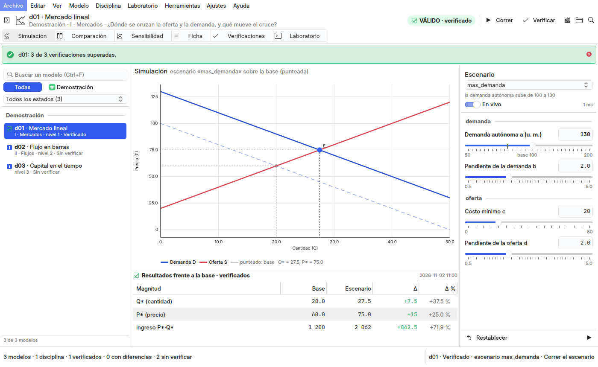
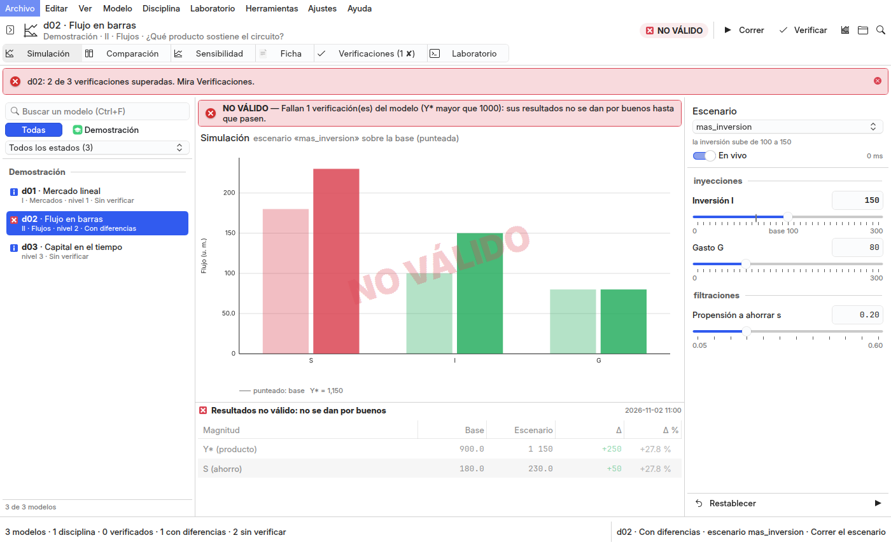

# studio/ — Simuladores Studio, el laboratorio de simulación (QML + Kirigami sobre gui-comun 3.0)
<!-- suite:inicio -->
**Suite `simuladores_studio`** · objetivo *publicacion* · estado *activo* · python · interfaz gui

Laboratorio de simulación (QML + Kirigami sobre gui-comun 3.0, VentanaBase): el catálogo de modelos por disciplina, el espacio de simulación con el gráfico que se redibuja al mover los parámetros (deslizadores con el rango del modelo), el escenario frente a la base lado a lado, la evolución temporal, la sensibilidad de un parámetro, los resultados numéricos, la ficha pedagógica y las verificaciones; un resultado solo se presenta como válido si las verificaciones del modelo pasan. F5 corre, Ctrl+T verifica, Ctrl+Intro exporta, guarda un escenario o regenera el catálogo tras confirmar.

- Escribe en: archivos · simula por defecto: sí
- Depende de: /usr/bin/python3 con PySide6 del sistema (python3-pyside6.*) y Kirigami (qml6-module-org-kde-kirigami), {'gui-comun 3.0 (módulo QML GuiComun': 'VentanaBase, escritorio, estados de operación)'}, .venv del repo con matplotlib para la figura académica, las fórmulas, los reportes y las CLI (requirements.txt; opcional), el motor del repo (base.py, navegador.py) y los modelos de cada disciplina, sin copiarlos
- Nota: No edita ningún modelo: correr y verificar calculan en proceso y escriben solo la caché del studio; exportar (salidas/ de la disciplina), guardar un escenario propio (datos del studio) y regenerar catalogo.json o navegador.json piden confirmación con la orden exacta.

Comandos:

```bash
main.py
main.py --smoke
../install.sh
```

<sub>Bloque generado desde `suite.yml` por `core/suites.py generar` (2026-11-02); no se edita a mano.</sub>
<!-- suite:fin -->

## Qué es

Un laboratorio de simulación al modo de MATLAB, RStudio y JupyterLab (`../docs/reingenieria.md`), sobre `VentanaBase`
de `gui-comun` 3.0:



- **El catálogo** (izquierda; F9 lo pliega): los modelos de `catalogo.json` por disciplina y sección, con su estado de
  verificación; Ctrl+F busca, los botones filtran por disciplina y el combo por estado.
- **El espacio de simulación** (centro; Ctrl+1–6): **Simulación** —o **Evolución temporal** cuando el eje x es el
  tiempo— con el gráfico grande del escenario sobre la base punteada y los resultados frente a la base; **Comparación**,
  base y escenario lado a lado con la misma escala, la lectura del escenario y las diferencias; **Sensibilidad**, el
  barrido de un parámetro sobre su rango declarado (`base.sensibilidad`) con el valor base y la derivada; **Ficha**, la
  ficha pedagógica (objetivo, fundamento, ecuaciones dibujadas con el `.venv`, variables, parámetros, supuestos,
  limitaciones, interpretación, referencias); **Verificaciones**; y **Laboratorio**, las demás operaciones con su orden
  exacta, el registro de la corrida y la salida del motor (F8).
- **Los parámetros** (derecha): el escenario (la base, los del modelo y los propios) y un deslizador por parámetro con
  el rango, el paso y la unidad que el modelo declara; el valor se escribe también a mano. **Mover un deslizador
  recalcula en vivo** (150 ms tras el último cambio); si un modelo tarda más de 400 ms, el modo en vivo se apaga para
  él y queda F5.
- **Validez**: una corrida solo se presenta como válida si el modelo está verificado con su archivo actual y sus
  números son finitos. Si no, el gráfico lleva «NO VÁLIDO» o «SIN VERIFICAR», los resultados se atenúan, el motivo va
  arriba y el chip de la cabecera lo dice. Al abrir un modelo sin estado se verifica solo.



**F5 corre, Ctrl+T verifica, Ctrl+Intro escribe tras confirmar.** Correr y verificar calculan en proceso con el motor
(`navegador.calcular`, `base.verificar`) y escriben solo la caché del studio; lo demás es la CLI del laboratorio
(`main.py` de la disciplina o de la raíz). Exportar el reporte y las figuras, exportar los datos del escenario,
guardar un escenario propio y regenerar `catalogo.json` o `navegador.json` muestran la orden exacta y lo que tocan, y
corren solo si se confirma. «Comprobar las citas» aparece solo en las disciplinas que tienen `main.py fuentes`. El
rigor es del motor: la ventana no edita ningún modelo.

## Uso

```bash
cd ~/Documents/simuladores
/usr/bin/python3 -m venv --system-site-packages .venv && .venv/bin/pip install -r requirements.txt   # una vez: matplotlib
/usr/bin/python3 studio/main.py            # (se relanza con .venv/bin/python si existe)
./install.sh                               # el acceso directo del menú (-n simula)
tests/run.sh                               # las pruebas del studio sobre el laboratorio de muestra
/usr/bin/python3 studio/capturar.py salida.png --esquema ~/Documents/lliphi/generado/esquema/LliphiOscuro.colors --modelo demo/d03 --valor s=0.35 --vista 1
```

Sin el `.venv` la ventana corre igual (correr y verificar un modelo: el motor registra un `matplotlib` vacío, como en
el navegador), pero no hay figura académica, fórmulas dibujadas, reportes ni CLI del laboratorio; avisa qué crear
(Herramientas › El entorno del studio…). PySide6 nunca va en el `.venv`: es el del sistema, el único que carga Kirigami.

## Estructura

```
studio/
├── main.py                 sin lógica: relanza con el .venv si existe y arranca sim_app.aplicacion
├── muestra.py · capturar.py   el laboratorio de muestra (motor real + disciplina demo) y las capturas sobre él
└── sim_app/
    ├── aplicacion.py       construir(): controladores y Acciones (menú, paleta, atajos, estados de operación); Main.qml
    ├── servicios/          sin Qt: rutas, laboratorio (disciplinas aisladas), corridas, simulacion (gráfico, sensibilidad,
    │                       validez), paleta (colores del modelo → roles del tema), verificaciones, fichas, formulas, operaciones
    ├── controladores/      espacio (filtros), modelos (catálogo, modelo actual, en vivo, base, sensibilidad, validez), operaciones, ajustes
    └── qml/                Main.qml sobre GuiComun.VentanaBase y componentes/ (CatalogoModelos, PanelParametros, GraficoCientifico,
                            EspacioSimulacion, Comparacion, Sensibilidad, Ficha, Verificaciones, Laboratorio, Operacion, Registro)
```

Los estados de verificación y las corridas viven en la caché del studio (`$XDG_CACHE_HOME/simuladores-studio/`); los
escenarios propios, en `$XDG_DATA_HOME/simuladores-studio/escenarios/`; nada de eso entra en el repo.

## Límite honesto

- **El modo en vivo es para modelos rápidos**: el cálculo corre en el hilo de la ventana (el motor, en proceso); un
  modelo que pasa de 400 ms por corrida apaga el modo en vivo y se corre con F5.
- **La sensibilidad barre alrededor de la base** (los valores por defecto del modelo, como `main.py sensibilidad`), no
  del escenario en edición.
- **Azul, morado y cian salen del tema solo si el tema los trae** (Breeze: el enlace es azul); con un acento rojo
  (Lliphi) se derivan con la saturación y la luminosidad de los colores semánticos del tema.
- **Una captura con esquema forzado** necesita el tema de Kvantum a juego (`capturar.py` lo escribe): con la
  `QApplication` de 3.0 los campos los pinta Kvantum con la paleta de su propio tema.
- **El recorrido guiado** (`main.py app`) se abre en su propia ventana matplotlib; no está dentro del studio.
